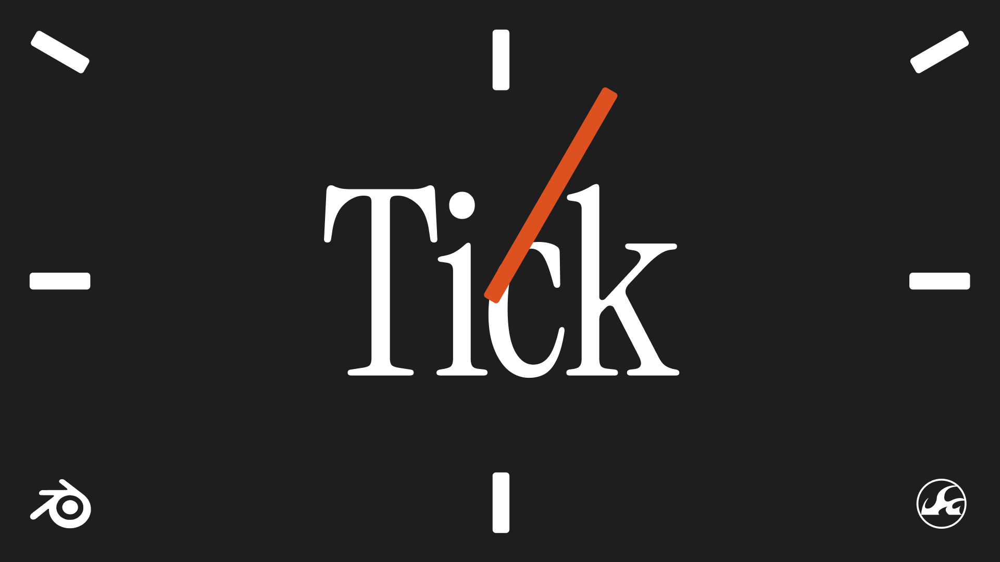
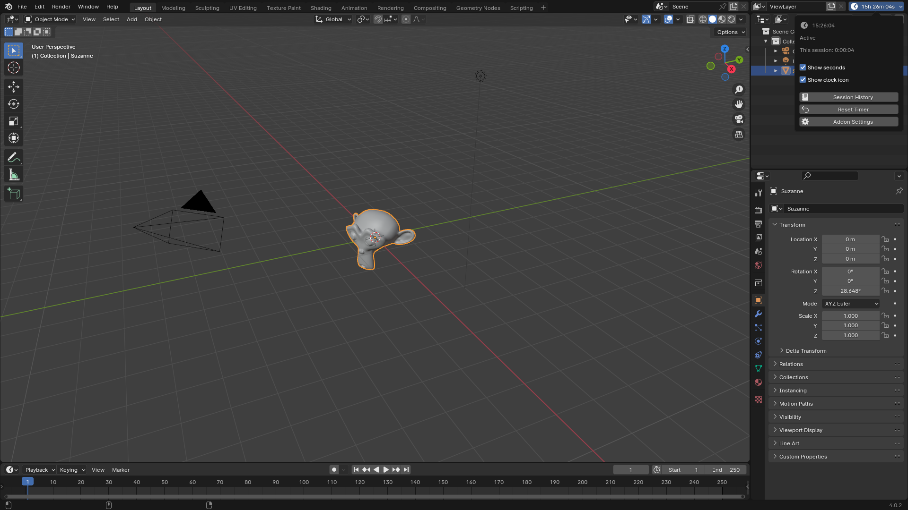
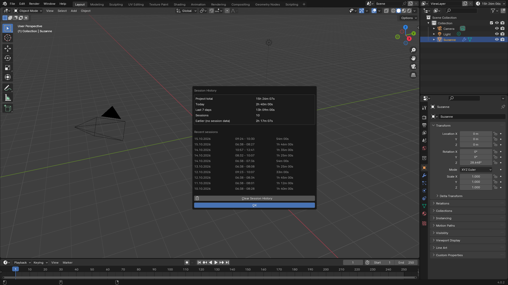
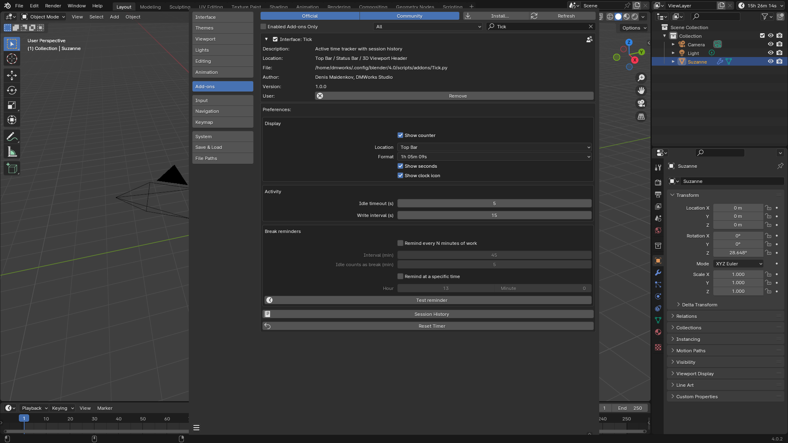
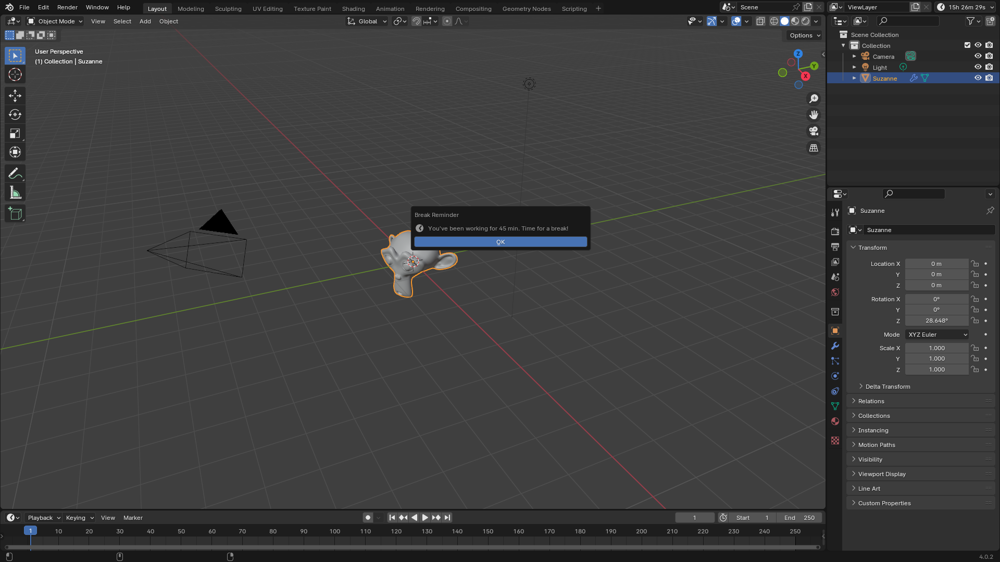

# Tick

Active time tracker with session history for Blender projects.
Активный таймер учёта времени с историей сессий для проектов Blender.


**by DMWorks Studio**

---

## Возможности

- Учёт **активного** времени работы над проектом — простой не считается
- Статистика: всего / сегодня / за 7 дней
- История сессий — до 1000 записей, хранится в самом .blend
- Время регулярно пишется в сцену, поэтому переживает вылеты и автосейвы
- Автопауза после N секунд без ввода
- Напоминания о перерыве — по интервалу или в заданное время
- Настраиваемый формат времени и место счётчика
- Работает во всех сценах файла, понимает данные старого *Project Timer*

## Скриншоты

| | |
|---|---|
|  |  |
|  |  |

## Установка

**Blender 4.2 и новее**
- Из Blender: *Edit → Preferences → Get Extensions* → найти **Tick** → *Install*;
- или скачать `tick-x.y.z.zip` из [Releases](../../releases) и перетащить в окно Blender.

**Blender 3.2 – 4.1**
- Скачать `Tick.py` из [Releases](../../releases) → *Edit → Preferences → Add-ons → Install…* → выбрать файл → включить **Tick**.

## Использование

Счётчик появляется в Top Bar, Status Bar или шапке 3D-вьюпорта (настраивается).
Клик по счётчику открывает поповер со статистикой, историей сессий и ссылкой на настройки.

| Действие | Где |
|---|---|
| Сбросить таймер проекта | Popover → *Reset Timer* |
| История сессий | Popover → *Session History* |
| Очистить историю | Окно истории → *Clear Session History* |
| Настройки | Popover → *Addon Settings* |

### Настройки

- **Display** — показывать счётчик, место, формат (`1:05:09` или `1h 05m 09s`), секунды, иконка
- **Activity** — Idle timeout (по умолчанию 5 с), Write interval (по умолчанию 15 с)
- **Break reminders** — каждые N минут работы, сброс интервала при простое, напоминание в конкретное время

## Как это работает

- Время хранится в свойстве сцены `projectTime` (целые секунды), история — JSON в `tickSessions`.
- По таймеру и перед сохранением (`save_pre`) данные пишутся во **все** сцены файла.
- При загрузке (`load_post`) берётся максимум по сценам — ничего не теряется.
- Сессия попадает в историю после **10 секунд** активной работы.
- Активность ловит модальный оператор, реагирующий на любое событие ввода.

## Сборка

```sh
blender --command extension build --output-dir dist
```

## Лицензия

GPL-3.0-or-later, см. [LICENSE](LICENSE).

Дополнительные условия (§7 GPLv3):
1. Уведомление об авторстве должно сохраняться.
2. Изменённые версии должны быть помечены как изменённые.
3. Названия «Tick» и «DMWorks Studio» не могут использоваться в модифицированных версиях.

## Авторы

- **Denis Maidenkov** / DMWorks Studio — автор Tick
- **Marcin Zielinski** — автор оригинального *Project Timer* (2013), на котором основан Tick
